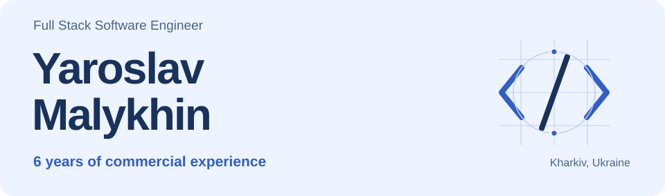
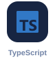
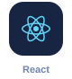
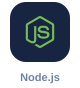
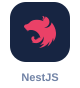
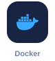

<picture>
  <source media="(prefers-color-scheme: dark) and (max-width: 480px)" srcset="assets/header-dark-mobile.svg">
  <source media="(max-width: 480px)" srcset="assets/header-light-mobile.svg">
  <source media="(prefers-color-scheme: dark)" srcset="assets/header-dark.svg">
  
</picture>

  <a href="https://www.linkedin.com/in/sk3llyar/"><strong>LinkedIn</strong></a>
  &nbsp; / &nbsp;
  <a href="mailto:sk3llyar@gmail.com"><strong>Get in touch</strong></a>

## Hey, I'm Yaroslav 👋

I'm a full stack engineer from **Kharkiv, Ukraine**, with **6 years of commercial experience** building web products. My core stack is **TypeScript, Node.js, and React** — and my work covers the full cycle, from requirements and architecture to interfaces, testing, and deployment.

I like being involved beyond a single layer: shaping the API, working through the data model, and bringing the feature to life on screen. I care about the details people notice when using a product, and the clarity developers need when maintaining it.

## What I bring to a project

- **⚙️ Backend that connects the pieces.** Modular Node.js services, APIs, database migrations, third-party integrations, caching, and background jobs.
- **🖥️ Interfaces for real workflows.** React and Next.js applications, dashboards, data-heavy views, forms, and responsive layouts.
- **🚀 A path from feature to release.** Automated tests, browser checks with Playwright, CI pipelines, and containerized environments.

## My everyday stack

  
  
  
  
  
  
  
  

<strong>The full toolbox</strong>

| Area | Technologies |
| --- | --- |
| Languages | TypeScript, JavaScript, SQL |
| Frontend | React, Next.js, Vite, HTML, CSS, Tailwind CSS |
| Backend | Node.js, NestJS, Fastify, Express |
| Data | PostgreSQL, Redis, SQLite, TypeORM |
| Testing | Jest, Vitest, Playwright |
| Tools & delivery | Git, GitHub Actions, Docker, Docker Compose, Linux |

## What I'm building now

My recent projects include **personal finance tools** and a **goal tracker with Notion integration**. I'm focusing on full-stack TypeScript, clear module boundaries, shared API contracts, and reliable background processing.
